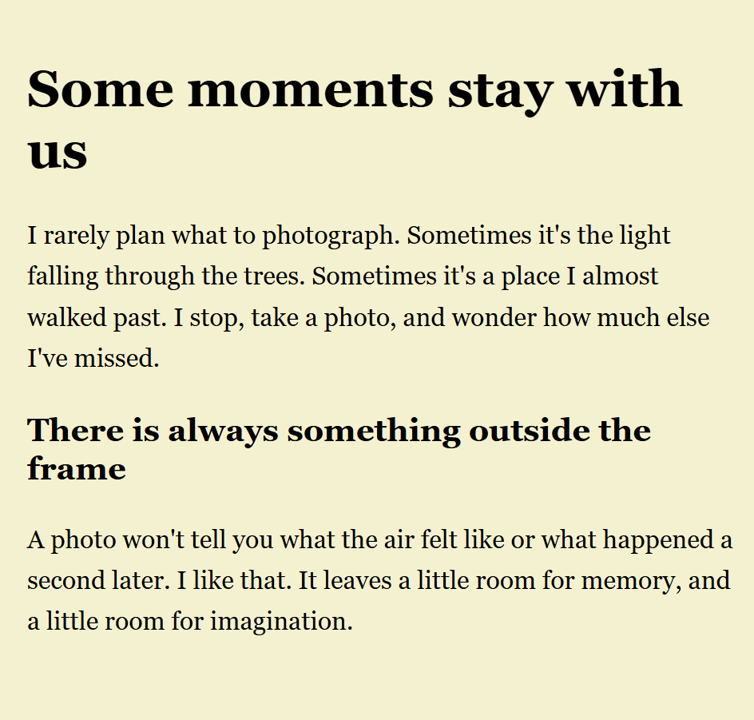
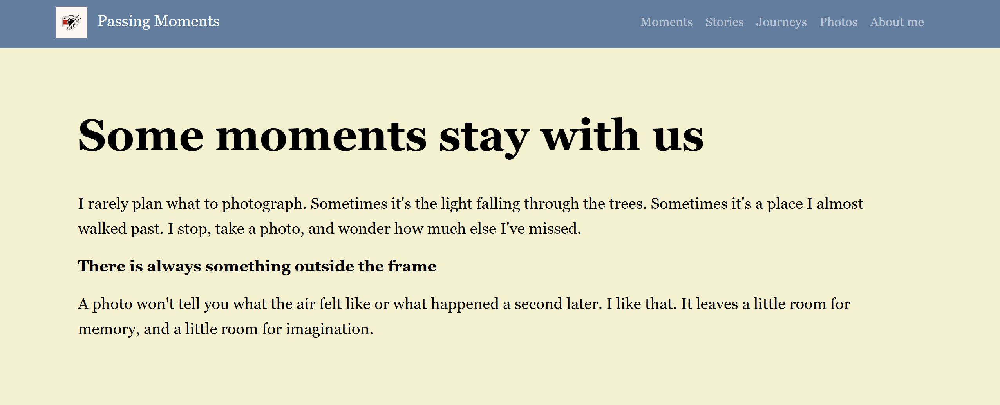
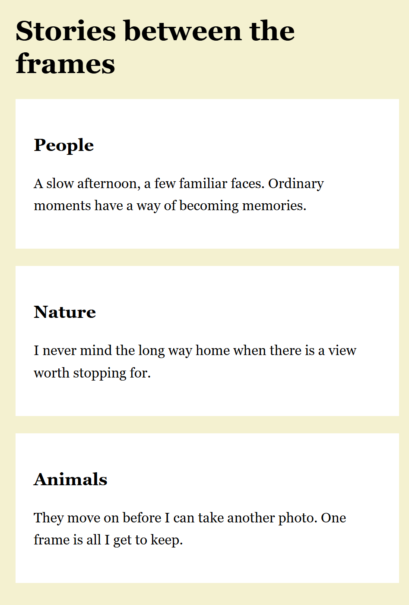
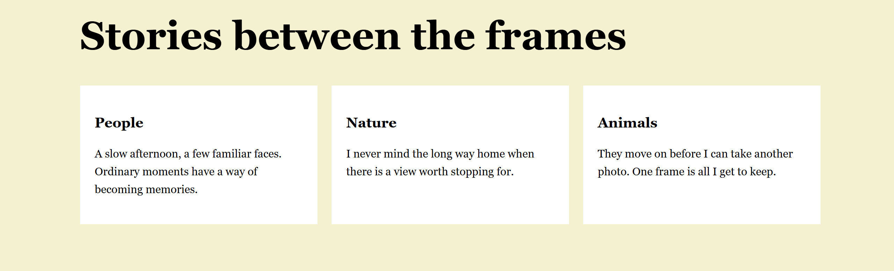
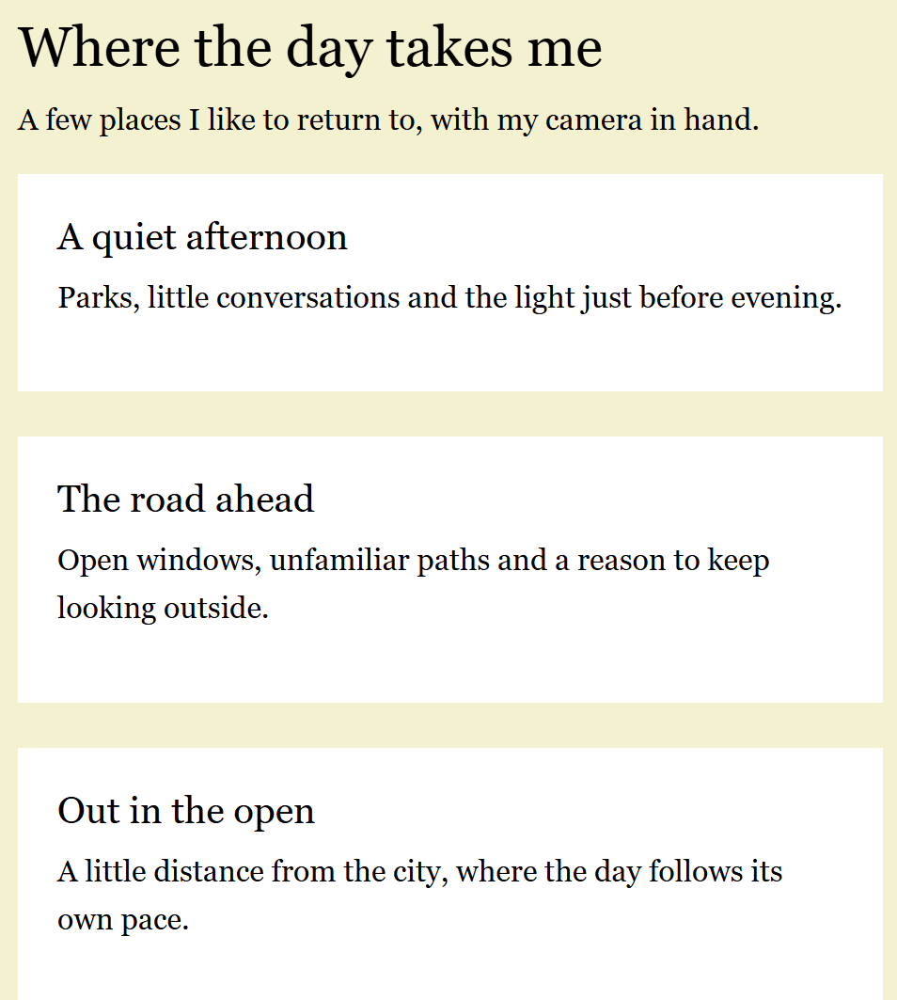
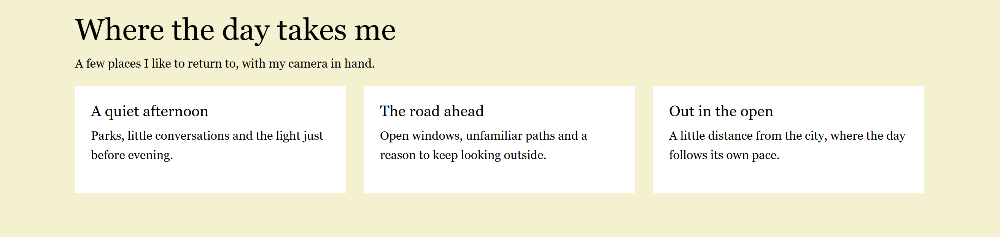
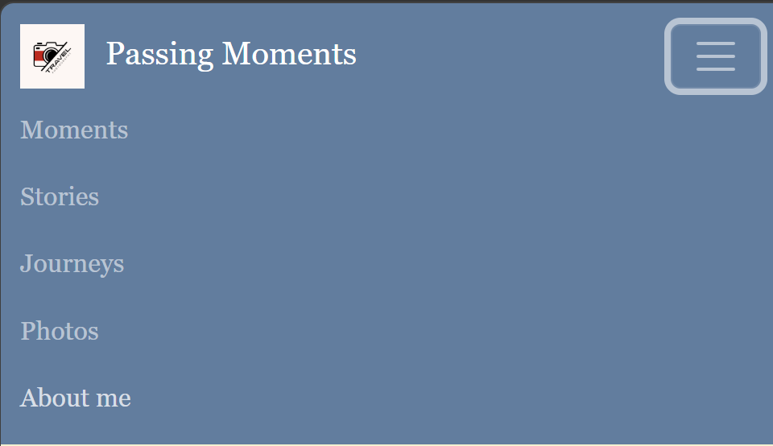
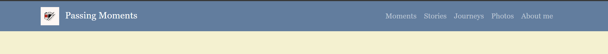
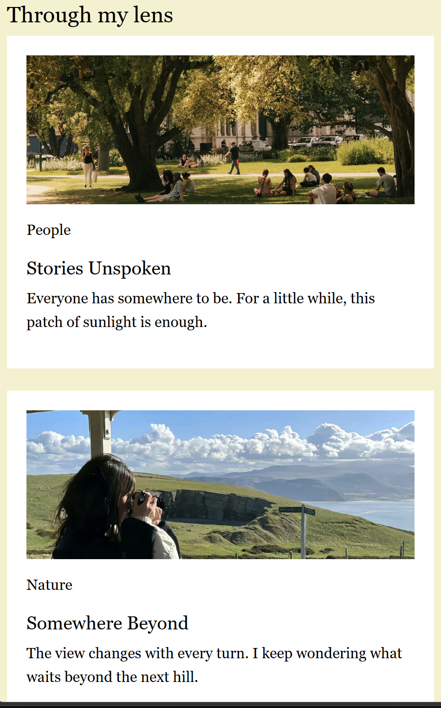
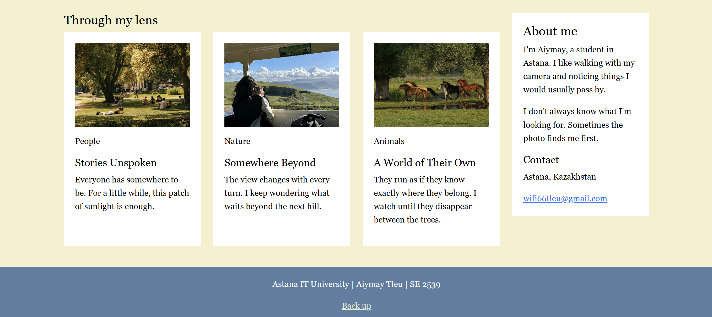

# Assignment 3 — Passing Moments

**Name:** Aiymay Tleu  
**Group:** SE 2539  
**Topic:** Passing Moments

## Project files

- `index.html` — Tasks 0–4.
- `style.css` — custom styles, CSS Grid and media queries.
- `images/`, `logo.png`, `icon.png` — photos, logo and browser icon.
- `vendor/` — Bootstrap CSS, JavaScript and license.
- `screenshots/` — mobile, tablet and desktop screenshots.

## Responsive layout

The page starts with a mobile layout. Media queries add changes for larger screens.

| Screen | Width | Boxes and cards |
| --- | --- | --- |
| Mobile | Below 768px | One per row |
| Tablet | 768–991px | Two, then one |
| Desktop | 992px and above | Three per row |

Screenshots show the page at 390px, 820px and 1440px, in that order.

## Task 0 — Responsive typography

In #typography, media queries change the heading and paragraph sizes.

| Text | Mobile | Tablet | Desktop |
| --- | --- | --- | --- |
| Main heading | 32px | 44px | 56px |
| Second heading | 24px | 30px | 36px |
| Paragraph | 16px | 18px | 20px |

## Task 1 — CSS layout

In #css-layout, three boxes use CSS Grid without Bootstrap. In the lecture 3, grid-template-columns defines the columns, repeat() repeats them, and gap adds space. Media queries switch between one, two and three columns. Bootstrap styles are limited to .bootstrap-area, outside Tasks 0–1.

## Task 2 — Bootstrap columns

In #bootstrap-layout, the columns use col-12 col-md-6 col-lg-4 inside a container and row. This follows the 12-column grid from lecture 4: each card takes 12, 6 or 4 columns depending on screen width. g-4 adds spacing.

## Task 3 — Bootstrap navbar

The navbar has a logo on the left and links on the right. navbar-expand-lg shows the full menu from 992px. On smaller screens, the hamburger button opens and closes the menu using Bootstrap JavaScript.

## Task 4 — Combined portfolio

In #portfolio, photo projects use col-12 col-lg-9, and the personal information sidebar uses col-12 col-lg-3. The sidebar moves below the projects on smaller screens. The page includes the navbar, a nested photo grid and a footer. Custom media queries adjust text and spacing and hide an extra note on mobile.

## Work process

I combined the tasks into one page and kept my photos, logo and colours. I used CSS Grid for the boxes and Bootstrap for the cards and menu. Then I checked the layouts and navigation on mobile, tablet and desktop and updated the screenshots.
